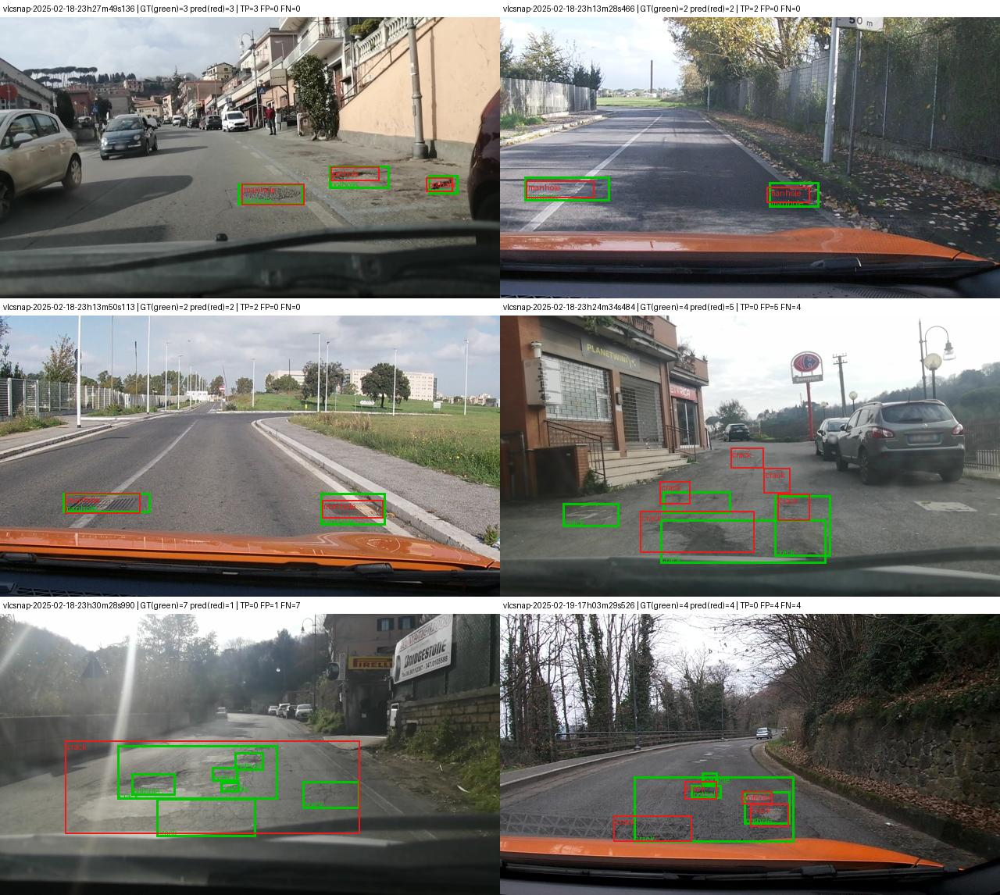

Họ tên: Vu Duc Thien
`dataset_version`: d10-21e4070301

## Bảng tổng hợp (số của bạn, lấy từ `report/evidence/*.json`)

| Mã | Setup | Tham số huấn luyện | VRAM đỉnh (GB) | Phút | F1 | CI95 | FP/ảnh | F1 pothole | F1 crack | F1 manhole |
|---|---|---|---|---|---|---|---|---|---|---|
| E0 | zero-shot | 0 | – | – | 0.088 | [0.062, 0.115] | 0.92 | 0.107 | 0.036 | 0.178 |
| E1 | LoRA LLM | 33,030,144 | 9.62¹ | 17.4 | 0.254 | [0.219, 0.291] | 1.29 | 0.184 | 0.175 | 0.526 |
| E2 | + projector | 142,135,296 | 8.04 | 17.8 | 0.335 | [0.298, 0.376] | 1.07 | 0.178 | 0.273 | 0.598 |
| E3 | + LoRA ViT | 148,426,752 | 8.22 | 22.4 | **0.405** | [0.360, 0.449] | 0.97 | 0.284 | 0.319 | 0.676 |
| E4 | `data_size` = 0.1 (E3, 142 ảnh) | 148,426,752 | 7.67 | 22.6 | 0.271 | [0.237, 0.306] | 1.69 | 0.212 | 0.182 | 0.567 |
| E4 | `data_size` = 1.0 (= E3) | 148,426,752 | 8.22 | 22.4 | 0.405 | [0.360, 0.449] | 0.97 | 0.284 | 0.319 | 0.676 |
| E5 | GRPO từ E3 (bonus) | 39,321,600² | 5.65² | 18.1 | **0.434** | [0.388, 0.481] | 0.80 | 0.320 | 0.337 | 0.706 |

Chung cho E1–E4: QLoRA NF4 (chỉ 252 Linear của LLM bị lượng tử hoá), r = 16, alpha = 32, lr 2e-4, batch 2 × tích luỹ 4, 300 bước, seed 42. Phần cứng: Colab **NVIDIA A100-SXM4-40GB** cho tất cả E0–E5 (log `nvidia-smi` lưu trong notebook là của session chạy E2–E5), vẫn giữ fp16 + GradScaler như cấu hình dành cho T4 của đề. VRAM đỉnh mọi thí nghiệm ≤ 9.62 GB, tức vẫn vừa T4 16 GB; còn thời gian (phút) là đo trên A100, chạy trên T4 sẽ lâu hơn. `parse_valid_rate`: E0 0.842 · E1 0.994 · E2 0.997 · E3, E4, E5 1.000.

¹ E1 được đo ngay sau ô chạy thử trong cùng session: ở bước 1 VRAM đỉnh đã là 8.51 GB, cao hơn cả đỉnh của E2 (8.04 GB) dù E2 có thêm projector float32. Lần chạy thử 10 bước với đúng cấu hình E1 (cùng batch, cùng model) chỉ đỉnh 6.35 GB. Vì vậy 9.62 GB nhiều khả năng gồm cả bộ nhớ còn sót lại từ các ô trước, không phải chi phí thật của E1. Bảng vẫn ghi đúng số trong `meta`.
² GRPO chỉ cập nhật LoRA của E3 (33,030,144 LLM + 6,291,456 ViT); projector giữ nguyên như SFT. E5 không có `meta` vì không thuộc E1–E3; thời gian lấy từ `report/e5_grpo_log.json`, VRAM đỉnh lấy từ log trong `lab_day10.ipynb` (mục 8).

Ảnh minh hoạ: `report/figures/` (dữ liệu: `data_samples.jpg`; dự đoán E3: `e3_good_1..3.jpg`, `e3_bad_1..3.jpg`, gộp trong `e3_examples.jpg`; loss: `loss_curves.png`; GRPO: `e5_grpo.png`). Số phân tích bổ sung tái lập bằng `python -m day10.analysis`.

## 10 câu hỏi (trả lời bằng **số của bạn**, không chép lại tài liệu)

### Câu 1 — Kiến trúc: ViT, projector và LLM của Qwen3-VL-4B có bao nhiêu tham số mỗi khối, và E1/E2/E3 mỗi cái cập nhật khối nào?

Đếm trên model đã nạp (số tham số gốc; với tensor 4-bit dùng kích thước trước khi nén):

| Khối | Tham số | Dạng lưu khi train |
|---|---|---|
| ViT (patch embed + 24 block) | 306.2M | fp16, đóng băng |
| Projector `visual.merger` | 27.3M | fp16 (E1) / float32 (E2, E3) |
| Projector `visual.deepstack_merger_list` (3 merger cho DeepStack) | 81.8M | như trên |
| LLM (36 lớp + embedding) | 4,022.5M | 252 Linear ở NF4, phần còn lại fp16 |
| **Tổng** | **4,437.8M** | |

Đường dữ liệu: ảnh 640×360 → ViT (patch 16, gộp 2×2 → 220 token) → projector chiếu sang không gian 2560 chiều của LLM; DeepStack đưa thêm đặc trưng từ các lớp giữa của ViT vào LLM → LLM sinh JSON.

Kiểm tra lượng tử hoá trên Colab cho `Linear 4-bit theo khối: {'llm': 252}`: đúng 36 × 7 phép chiếu của LLM; ViT, projector và `lm_head` vẫn ở fp16.

Khối được cập nhật và số tham số huấn luyện (từ `meta`):
- **E1**: chỉ LoRA trên 252 module LLM (q, k, v, o, gate, up, down). Mỗi lớp có r·(vào + ra) = 917,504 tham số, × 36 lớp = **33,030,144** (0.74% tổng). ViT và projector đóng băng.
- **E2**: E1 + toàn bộ projector: 142,135,296 − 33,030,144 = **109,105,152** tham số (đúng bằng 27.3M + 81.8M).
- **E3**: E2 + LoRA trên 96 module ViT (`attn.qkv`, `attn.proj`, `mlp.linear_fc1/2` × 24 block): 148,426,752 − 142,135,296 = **6,291,456** tham số (262,144 mỗi block).

### Câu 2 — E0: `parse_valid_rate` bằng bao nhiêu, và hai lỗi phổ biến nhất của model gốc là gì (kèm một ví dụ output thô)?

`parse_valid_rate` = **0.842**: 262/311 output hợp lệ, 49 hỏng. F1 = 0.088 (P 0.122, R 0.069).

1. **Bịa box và lặp box đến khi bị cắt.** 45/49 output hỏng là do model liệt kê box `crack` dịch dần từng chút một, chạy đến hết `max_new_tokens = 256` nên JSON bị cắt giữa chừng. Ví dụ thô:
   `… {"label": "crack", "bbox_2d": [580, 350, 600, 360]}, {"label": "crack", "bbox_2d": [600, 350, 620, 360]}, {"label": "crack", "bbox_2d": [620, 350, 640, 360]}, {"label": "crack", "bbox_2d": [640, 350,`
   Cũng vì thế mà crack có 194 FP (F1 crack chỉ 0.036).
2. **Bỏ sót và box sai kích thước.** Trung bình model chỉ trả 1.05 box/ảnh trong khi GT có 1.88 box/ảnh, nên recall chỉ 0.069. Box của E0 chiếm trung bình 6.2% khung hình, trong khi GT có trung vị 0.4–2% tuỳ lớp: box quá to so với hư hại.

Lỗi hiếm gặp hơn: 4 output sai cú pháp, ví dụ `[287, 478, 357, 500)}]`. Model **không** bọc ```json (0/311 output) và đã dùng đúng thang 0–1000: toạ độ lớn nhất là 1000, và các box khớp được có IoU trung bình 0.60. Vậy lỗi của E0 không phải do sai thang mà do không biết "hư hại mặt đường" trông như thế nào và không biết khi nào dừng.

### Câu 3 — Thang 0–1000: nếu chấm output theo pixel (hoặc ngược lại) thì F1 ra sao và vì sao? Bạn đã kiểm chứng điều này thế nào?

Qwen3-VL biểu diễn toạ độ bằng số nguyên tương đối trên thang 0–1000, nên một box có cùng con số dù ảnh có độ phân giải bao nhiêu (ViT còn resize ảnh 360 → 352 px). Model chỉ phải học một tập token toạ độ cố định, và quy ước này khớp với dữ liệu pretrain grounding (E0 chưa finetune đã trả toạ độ trong 0–1000).

**Kiểm chứng:** chấm lại đúng file dự đoán của E3 bằng `score.py --coord pixel` (`work/checks/best_as_pixel.json`): **F1 từ 0.405 rơi xuống 0.000**, với TP = 0, FP = 528, FN = 583, dù `parse_valid_rate` vẫn là 1.0. Khi một số trên thang 0–1000 bị đọc như pixel, toạ độ x bị nhân 1000/640 = 1.56 và y bị nhân 1000/360 = 2.78. Box vì thế bị kéo dãn và đẩy xuống góc dưới bên phải, nhiều box ra ngoài khung, nên không box nào còn IoU ≥ 0.5 với GT. Trường hợp ngược lại (học nhãn pixel mà chấm theo 0–1000) thì box bị co về góc trên bên trái theo hệ số 0.64 và 0.36, cũng cho F1 ≈ 0. Đây đúng là triệu chứng "F1 ≈ 0 dù JSON hợp lệ" trong bảng sự cố của GUIDE.

**Kiểm chứng nhãn:** quy ngược YOLO → 0–1000 → pixel cho toàn bộ 3,515 box train: sai số trung vị 0.24 px (do làm tròn tới 1/1000). Sai số lớn nhất là 5 px, chỉ ở 49 box vốn tràn ra ngoài khung ảnh và bị kẹp về [0, 1000]. Ô mục 2 của notebook vẽ box dựng lại từ JSON chồng lên box gốc và chúng trùng nhau.

### Câu 4 — Mask loss: vì sao chỉ tính loss trên phần trả lời? Điều gì xảy ra nếu tính trên cả prompt và token ảnh?

Một ví dụ điển hình có **371 token = 220 token ảnh + 92 token prompt/template + 59 token trả lời** (trung vị trên train, đã tính `<|im_end|>\n`). Như vậy chỉ **15.9%** token được tính loss. Ảnh train đầu tiên có box (9 box, in trong mục 4 của notebook) có 562 token, trong đó 250 token trả lời (44.5%). Giải mã riêng các vị trí `labels != -100` cho ra đúng chuỗi JSON đáp án và kết thúc bằng `<|im_end|>`.

Lý do chỉ tính loss trên phần trả lời:
- Mục tiêu là p(JSON | ảnh, prompt). 220 vị trí ảnh chỉ là token giữ chỗ `<|image_pad|>` (embedding của chúng bị thay bằng đặc trưng ViT), nên "dự đoán" token giữ chỗ tiếp theo là vô nghĩa.
- Prompt **giống hệt nhau ở cả 1,422 ảnh**, nên model thuộc lòng nó gần như ngay lập tức.
- Nếu tính loss trên cả chuỗi, khoảng 84% token còn lại cho loss gần 0 và kéo trung bình xuống. Gradient của phần JSON bị pha loãng khoảng 6 lần (1/0.159), và đường loss trông rất đẹp trong khi toạ độ chưa học được. Model cũng bị đẩy về phía sinh lại prompt thay vì trả lời.

Mình không chạy thử biến thể không mask, nên phần hậu quả trên là suy luận chứ không phải số đo. Bằng chứng gián tiếp: với mask đúng (gồm cả `<|im_end|>`), model học được cả nội dung lẫn điểm dừng. `parse_valid_rate` tăng từ 0.842 (E0) lên 0.994–1.000 (E1–E3), và lỗi lặp box đến hết 256 token biến mất.

### Câu 5 — Vì sao không thể huấn luyện đầy đủ projector nếu ViT bị lượng tử hoá 4-bit, và bạn đã xử lý thế nào? Vì sao projector phải ở float32?

Projector nằm trong `model.visual` (`visual.merger`, `visual.deepstack_merger_list`). Nếu ViT bị lượng tử hoá, các Linear này thành `Linear4bit` của bitsandbytes: trọng số được lưu dưới dạng `uint8` nén hai giá trị NF4 mỗi byte, cộng thêm hằng số tỉ lệ (`quant_state`). Đó không phải tensor số thực, nên optimizer không có gì để cập nhật trực tiếp; chỉ gắn được LoRA lên trên. Vì vậy phải bỏ qua `visual` khi lượng tử hoá.

**Lỗi mình phát hiện:** cấu hình trong GUIDE `llm_int8_skip_modules=["visual", "lm_head"]` **không** bỏ qua được ViT với transformers 5.19. Thư viện so pattern bằng `re.match` từ **đầu** tên module, mà tên thật là `model.visual.blocks.0.attn.qkv`. Mình kiểm chứng bằng chính hàm `should_convert_module` trên một model Qwen3-VL thu nhỏ: với `"visual"`, 20/20 Linear của ViT vẫn bị đổi sang 4-bit. Code dùng `["model.visual", "lm_head"]` và có hàm `check_quantization` báo lỗi nếu ViT, projector hoặc `lm_head` có Linear 4-bit. Trên Colab kết quả là `{'llm': 252}`.

Projector phải ở float32 vì hai lý do:
1. `GradScaler.unscale_()` từ chối gradient fp16 (lỗi `Attempting to unscale FP16 gradients`). Tham số LoRA của PEFT vốn đã là float32; projector phải được đưa về float32 cho đồng bộ (code kiểm tra mọi tham số huấn luyện đều là float32).
2. fp16 chỉ có 10 bit phần định trị: quanh giá trị 1 (ví dụ trọng số LayerNorm của merger), bước nhỏ nhất là 2⁻¹⁰ ≈ 1e-3, lớn hơn bước cập nhật AdamW cỡ lr = 2e-4. Cập nhật vì vậy bị làm tròn mất, và càng về cuối lịch cosine (lr → 0) thì càng nhiều trọng số không đổi. Trạng thái Adam cũng hỏng: moment bậc hai v ≈ g² với g cỡ 1e-5 là 1e-10, nhỏ hơn số dương nhỏ nhất của fp16 (≈ 6e-8), nên bị làm tròn về 0.

Chi phí lý thuyết: 109.1M tham số × (4 B trọng số + 4 B gradient + 8 B Adam) ≈ 1.75 GB.

Vấn đề tương tự xuất hiện ở E5: TRL tự đổi tham số huấn luyện của model lượng tử sang bf16 (chỉ 7 bit định trị). Với lr 5e-6, phần lớn cập nhật nhỏ hơn bước nhỏ nhất của bf16 quanh trọng số LoRA và bị làm tròn mất, nên code đưa chúng về float32 trước khi optimizer được tạo.

### Câu 6 — Split theo phiên quay: vì sao chia ngẫu nhiên sẽ cho F1 cao giả? Số ảnh và số box từng lớp ở mỗi split là bao nhiêu?

| Split | Ảnh | Phiên quay | pothole | crack | manhole |
|---|---|---|---|---|---|
| train | 1,422 | 13 | 1,074 | 1,750 | 691 |
| val | 276 | 2 | 66 | 470 | 103 |
| test | 311 | 3 | 121 | 299 | 163 |

Đã kiểm tra: không có phiên nào nằm ở hai split, và `dataset_version` là d10-21e4070301 cả trên Colab lẫn trên máy.

2,009 ảnh chỉ đến từ **18 phiên quay**. Trong các ảnh có mốc thời gian ở tên file (1,695 ảnh), hai frame liền kề trong cùng phiên cách nhau trung vị **2.1 giây**, và có 1,292 cặp cách nhau ≤ 5 giây. Đo độ khác biệt pixel (ảnh xám 64×36): cặp frame ≤ 5 giây khác nhau trung vị **18.5**, còn cặp ảnh khác phiên khác nhau **57.3**, tức gấp khoảng 3 lần.

Nếu chia ngẫu nhiên, gần như mọi ảnh test sẽ có một "bản sao" cách vài giây nằm trong train: cùng ổ gà, cùng góc camera, cùng ánh sáng. Model chỉ cần nhớ cảnh là đoán trúng, nên F1 trên test đo khả năng nhớ chứ không đo khả năng tổng quát hoá sang con đường mới. Khi triển khai trên cung đường khác, F1 thật sẽ thấp hơn nhiều. Mình không huấn luyện thêm một lần với split ngẫu nhiên để đo mức chênh, nên kết luận này dựa trên số đo về độ giống nhau giữa các frame.

Hệ quả của việc chia theo phiên: phân bố lớp lệch giữa các split (val chỉ có 66 pothole, test chỉ gồm 3 phiên), nên phải đọc F1 theo từng lớp và nhìn CI95.

### Câu 7 — So sánh E1/E2/E3: mở projector và LoRA trên ViT có đáng không (F1, CI95, VRAM, thời gian)?

| | F1 (CI95) | ΔF1 so với bước trước (bootstrap ghép cặp, CI95) | Thêm tham số | Thêm thời gian | VRAM đỉnh |
|---|---|---|---|---|---|
| E1 | 0.254 [0.219, 0.291] | +0.166 [+0.128, +0.205] so với E0 | 33.0M | 17.4 phút | 9.62 GB¹ |
| E2 | 0.335 [0.298, 0.376] | **+0.081 [+0.046, +0.117]** | +109.1M | +0.4 phút | 8.04 GB |
| E3 | 0.405 [0.360, 0.449] | **+0.070 [+0.029, +0.114]** | +6.3M | +4.6 phút (+26%) | 8.22 GB |

Cả hai bước đều **đáng**: khoảng tin cậy của chênh lệch đều nằm hẳn trên 0, trong khi chi phí nhỏ.
- **Mở projector (E2)** gần như không tốn thêm thời gian. Nó cải thiện chủ yếu crack (0.175 → 0.273) và manhole (0.526 → 0.598): projector quyết định đặc trưng ảnh nào được chuyển sang LLM, nên chỉ chỉnh LLM (E1) là không đủ.
- **LoRA trên ViT (E3)** chỉ thêm 6.3M tham số nhưng tốn thêm 26% thời gian (gradient phải đi ngược qua 24 block ViT) và +0.18 GB VRAM. Đổi lại, cả ba lớp đều tăng, rõ nhất là pothole (0.178 → 0.284): ViT gốc chưa được dạy để phân biệt kết cấu nhỏ của ổ gà và vết nứt.
- E3 cũng có FP/ảnh thấp nhất (0.97 so với 1.29 của E1). Đường loss trong `report/figures/loss_curves.png` xếp đúng thứ tự E3 < E2 < E1 ở cuối quá trình (trung bình 10 bước cuối: 0.50 / 0.54 / 0.58).

Setup đáng đồng tiền nhất là **E3**: F1 cao nhất, tăng 0.151 [+0.112, +0.194] so với E1, chỉ thêm 4.6 phút (đo trên A100), và VRAM 8.22 GB vẫn nằm trong giới hạn 16 GB của T4. Về VRAM, theo lý thuyết thứ tự phải là E3 > E2 > E1. Số của E1 bị đội lên do bộ nhớ còn sót trong session (xem chú thích ¹); đo sạch với cấu hình E1 chỉ 6.35 GB. Vậy mở projector float32 tốn khoảng +1.7 GB, và LoRA ViT thêm khoảng +0.2 GB.

### Câu 8 — Tập test có 311 ảnh: khoảng tin cậy rộng thế nào, và điều đó giới hạn kết luận so sánh các setup ra sao?

CI95 bootstrap (lấy lại mẫu theo ảnh, 1,000 lần) rộng **0.053–0.093 điểm F1**: E0 0.053, E1 0.072, E2 0.078, E3 0.089, E5 0.093. Mức chênh giữa hai setup liền nhau (0.07–0.08) chỉ bằng khoảng một độ rộng CI.

Nếu chỉ so hai CI riêng lẻ thì nhiều kết luận nghe không chắc. Ví dụ CI của E2 [0.298, 0.376] và E3 [0.360, 0.449] chồng nhau ở đoạn 0.360–0.376; tương tự E3 và E5. Nhưng mọi setup đều được chấm trên **cùng 311 ảnh**, nên lỗi của chúng tương quan với nhau. Mình làm bootstrap **ghép cặp** (cùng một mẫu ảnh cho cả hai model, `day10/report.py: paired_bootstrap_f1`):

| So sánh | ΔF1 | CI95 của Δ | Kết luận |
|---|---|---|---|
| E1 − E0 | +0.166 | [+0.128, +0.205] | chắc chắn |
| E2 − E1 | +0.081 | [+0.046, +0.117] | chắc chắn |
| E3 − E2 | +0.070 | [+0.029, +0.114] | chắc chắn, dù hai CI riêng chồng nhau |
| E5 − E3 | +0.029 | [+0.012, +0.046] | nhỏ nhưng nhất quán |
| E4 (10%) − E1 | +0.017 | [−0.020, +0.052] | **không** phân biệt được |

Những gì **không** kết luận được với 311 ảnh:
- **So sánh theo lớp.** pothole chỉ có 121 box trong test, nên F1 pothole của E1 và E2 (0.184 so với 0.178) là như nhau.
- **Mức chênh nhỏ hơn khoảng 0.03.**
- **Độ tin cậy thật thấp hơn con số CI.** Test chỉ gồm **3 phiên quay**, nên ảnh không độc lập với nhau. Bootstrap theo ảnh vì vậy đánh giá thấp độ bất định khi chuyển sang con đường khác.
- **Biến động giữa các lần train không được tính.** Mỗi setup chỉ chạy một seed, nên CI chỉ phản ánh nhiễu do tập test.

Mỗi setup chỉ được chấm trên test một lần; khi gỡ lỗi mình dùng 8 ảnh val.

### Câu 9 — Phân tích lỗi theo lớp: lớp nào kém nhất và vì sao (kích thước box, số mẫu, ngữ nghĩa)? Kèm ảnh minh hoạ.

Với setup tốt nhất E3, **pothole kém nhất (F1 0.284, recall 0.264)**, tiếp theo là crack (F1 0.319); manhole tốt nhất (0.676, recall 0.601). Ở E0 thì crack kém nhất (0.036) vì model gốc bịa rất nhiều box crack.

| Lớp | Box train | Diện tích trung vị (test) | Tỷ lệ box thuộc nhóm nhỏ nhất | Recall E3 |
|---|---|---|---|---|
| pothole | 1,074 | 0.42% khung hình | 65% | 0.264 |
| crack | 1,750 | 1.98% | 11% | 0.318 |
| manhole | 691 | 0.67% | 50% | 0.601 |

- **Kích thước:** chia GT test thành 3 nhóm diện tích bằng nhau. Recall E3 ở nhóm nhỏ (≤ 0.67% khung hình) là 0.32, ở nhóm vừa là 0.45. Ổ gà nhỏ nhất và nằm nhiều nhất ở nhóm nhỏ. Sau khi ViT gộp patch, mỗi token ảnh ứng với 32×32 pixel, nên một ổ gà 0.4% khung (khoảng 30×30 px) chỉ chiếm chừng một token.
- **Số mẫu không phải nguyên nhân chính:** manhole có ít box train nhất (691) nhưng lại tốt nhất.
- **Ngữ nghĩa:** nắp cống có hình dạng đều, viền rõ, tương phản cao. Ổ gà và vết nứt thì lẫn vào nhau, lẫn với mảng vá và bóng râm. Trong 303 dự đoán không khớp của E3: **131 bị lệch vị trí** (đúng lớp nhưng 0.1 ≤ IoU < 0.5), **46 nhầm lớp** (trùng box GT của lớp khác), và **126 bịa trên nền**.
- **Crack** khó vì ranh giới mơ hồ: GT có khi là một box dài bao cả vết nứt, có khi chia thành nhiều box nhỏ, nên rất khó đạt IoU ≥ 0.5.

Ảnh minh hoạ, với box xanh là GT và box đỏ là dự đoán E3:



- `e3_good_1..3`: chủ yếu là nắp cống rõ nét gần xe. TP bằng số GT, không có FP.
- `e3_bad_1`: mặt đường xuống cấp có 4 GT. Model đặt 5 box nhưng đều lệch vị trí hoặc sai kích thước, nên TP = 0.
- `e3_bad_2`: một đoạn đường có 7 hư hại nhỏ (7 GT). Model gộp tất cả thành **một box crack khổng lồ**, đúng lỗi "độ chi tiết của nhãn" nêu ở trên.
- `e3_bad_3`: 4 hư hại nhỏ trên đường dốc. Box dự đoán rơi đúng vùng nhưng lệch và sai kích thước, IoU < 0.5.

### Câu 10 — E4: bạn đổi biến nào, kết quả thế nào, và kết luận có đáng tin không?

Mình đổi **`data_size`** trên setup tốt nhất E3: **10%** (142 ảnh lấy ngẫu nhiên với seed 42) so với **100%** (1,422 ảnh, chính là lần chạy E3). Mọi thứ khác giữ nguyên, kể cả 300 bước và batch hiệu dụng 8. `e4_data_1.0.json` là kết quả chấm lại đúng file dự đoán của E3.

| | F1 | CI95 | P / R | FP/ảnh | box/ảnh | loss 10 bước cuối |
|---|---|---|---|---|---|---|
| 10% | 0.271 | [0.237, 0.306] | 0.248 / 0.298 | 1.69 | 2.25 | **0.011** |
| 100% | 0.405 | [0.360, 0.449] | 0.426 / 0.386 | 0.97 | 1.70 | 0.50 |

- Bớt 90% dữ liệu làm F1 giảm **0.134**; bootstrap ghép cặp cho CI95 của chênh lệch là [+0.092, +0.177], và hai CI riêng không chồng nhau.
- Vì giữ nguyên 300 bước, bản 10% đi qua mỗi ảnh khoảng **17 lần** (300 × 8 / 142), so với khoảng 1.7 lần của bản 100%. Loss train về **0.011**, tức model thuộc lòng nhãn. Trên test nó sinh nhiều box hơn GT (2.25 so với 1.88 box/ảnh) và FP/ảnh tăng 74%: đây là overfit.
- Một kết quả phụ đáng chú ý: E3 chỉ với 10% dữ liệu (0.271) **ngang** E1 với toàn bộ dữ liệu (0.254). Chênh lệch +0.017 có CI95 [−0.020, +0.052], chứa 0. Tức là cập nhật cả phía thị giác bù được lượng dữ liệu gấp 10 lần, nhưng 311 ảnh test không đủ để nói bên nào hơn.

**Mức độ tin cậy:**
- Chiều của kết luận ("nhiều dữ liệu hơn thì tốt hơn rõ rệt") **đáng tin**: CI của chênh lệch cách xa 0.
- Độ lớn 0.134 thì **không chắc**. Kết quả chỉ dựa trên một tập con 142 ảnh và một seed; với tập con khác, hoặc nếu giảm số bước cho cùng số epoch, con số có thể khác. Test cũng chỉ có 3 phiên quay (xem Câu 8).

## E5 (bonus): GRPO với reward IoU

- **Reward** (`day10/reward.py`): trả 0 nếu JSON hỏng; trả 1 nếu cả GT và dự đoán đều rỗng; ngược lại trả 0.2 + 0.8 · ΣIoU / max(n_gt, n_pred, 1), với các cặp được ghép tham lam theo IoU giảm dần, cùng lớp, chỉ nhận IoU ≥ 0.5. GT được tạo bằng cùng công thức với `score.py`.
- **Test** (`day10/tests/test_reward.py`, chạy `python -m pytest day10/tests -q`): 5 ca bắt buộc (hoàn hảo 1.0, JSON hỏng 0.0, sai nhãn 0.2, thừa box 0.6, cùng rỗng 1.0), cộng thêm box khổng lồ 0.2, `[]` khi có GT 0.2, IoU dưới ngưỡng, box suy biến và định dạng completion của TRL.
- **Chạy:** `trl==1.9.2`, khởi tạo từ adapter E3. 60 bước, lr 5e-6, beta 0, 4 lần sinh cho mỗi prompt, 2 prompt mỗi bước (tổng 120 ảnh train), `max_completion_length` = 128. Mất 18.1 phút trên A100, VRAM đỉnh 5.65 GB. Log ở `report/e5_grpo_log.json`, biểu đồ ở `report/figures/e5_grpo.png`. Có 2 bước (23 và 55) bị GradScaler fp16 bỏ qua vì gradient tràn số.

**So với SFT (E3):** F1 tăng từ 0.405 lên **0.434** [0.388, 0.481]. Bootstrap ghép cặp cho Δ = **+0.029, CI95 [+0.012, +0.046]**: nhỏ nhưng nhất quán, dù hai CI riêng chồng nhau. Phần tăng đến từ precision (0.426 → 0.481, FP/ảnh 0.97 → 0.80); recall gần như giữ nguyên (0.386 → 0.395). F1 của cả ba lớp đều tăng nhẹ (pothole 0.284 → 0.320, crack 0.319 → 0.337, manhole 0.676 → 0.706).

**Có reward hacking không?** Không thấy dấu hiệu:
- **Không lười trả `[]`:** tỷ lệ output rỗng là 0% ở cả E3 và E5.
- **Không có box khổng lồ:** diện tích box trung bình 2.2% khung hình ở E3, 2.5% ở E5.
- **Model chỉ thận trọng hơn:** trên test, số box giảm từ 1.70 xuống 1.54 box/ảnh; trong lúc train GRPO, completion ngắn lại (trung bình 59 → 52 token, 10 bước đầu so với 10 bước cuối). Đây đúng là hướng mà mẫu số max(n_gt, n_pred) khuyến khích. Nếu model đang hack bằng cách bỏ sót thì recall phải giảm, nhưng recall không giảm.

Điểm cần lưu ý cho phân tích:
- Mức sàn 0.2 khiến `[]` "an toàn" khi model không chắc, nên mô hình có thể bị đẩy về phía bỏ sót nếu chạy lâu hơn.
- Tỷ lệ nhóm có cả 4 reward bằng nhau (không có gradient) tăng từ 0 (10 bước đầu) lên 0.15 (10 bước cuối).
- Reward trung bình không tăng rõ (0.44 → 0.40), vì mỗi bước dùng ảnh khác nhau nên nhiễu lớn. Kết quả chỉ từ một lần chạy 60 bước.

## Nhìn lại

- **Lỗi cấu hình mà công cụ chấm không bắt được:** pattern `"visual"` trong `llm_int8_skip_modules` (GUIDE và đề trên web) không khớp tên `model.visual…` trong transformers 5.x, nên ViT và projector bị lượng tử hoá âm thầm. Code vẫn chạy, và E2/E3 sẽ "chạy" nhưng không huấn luyện được projector. Mình chỉ phát hiện ra nhờ đọc mã của transformers và đếm `Linear4bit` theo khối.
- **Các bẫy phiên bản khác:**
  - transformers 5.x **báo lỗi** nếu thiếu `mm_token_type_ids` trong batch; đoạn mã collate trên web bỏ trường này.
  - Mã trên web chọn module LoRA cho E3 theo hậu tố (`"linear_fc1"`), nên khớp nhầm vào projector và thiếu `attn.proj` (ra 332 module thay vì 348).
  - torchao 0.10 có sẵn trên Colab làm `peft` 0.21 không import được.
  - TRL đổi tham số LoRA sang bf16.
- **`meta` không được kiểm tra tính hợp lý:** VRAM của E1 bị đội lên vì bộ nhớ còn sót trong session (9.62 GB so với 6.35 GB đo sạch), nhưng `check_submission.py` chỉ kiểm tra là số dương. Nếu làm lại, mình sẽ chạy mỗi thí nghiệm trong một session mới.
- **Dữ liệu:** 49 box GT tràn ra ngoài khung ảnh, phải kẹp về [0, 1000]. Nhãn crack không nhất quán về độ chi tiết (một box lớn hay nhiều box nhỏ), nên IoU ≥ 0.5 đánh giá rất khắt khe với lớp này. `score.py` coi **cả output** là hỏng nếu chỉ một box suy biến, nên phải nới các box rất nhỏ ra ít nhất 1 đơn vị khi tạo nhãn.
- **Điều mình chưa hiểu hết:**
  - Vì sao F1 của E5 tăng dù reward trung bình khi train không tăng. Có thể do GRPO chủ yếu làm giảm các box thừa, nhưng 60 bước và một seed chưa đủ để khẳng định.
  - Mức F1 bị thổi phồng khi chia ngẫu nhiên. Mình mới đo độ giống nhau giữa các frame, chưa huấn luyện lại để đo trực tiếp.
